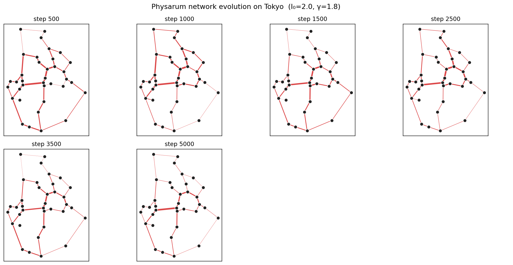
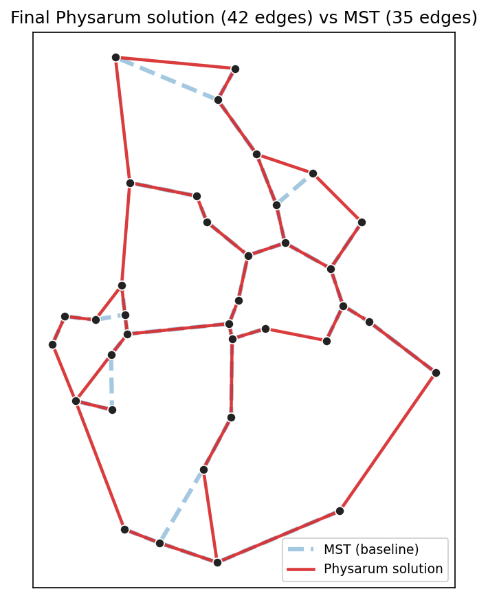
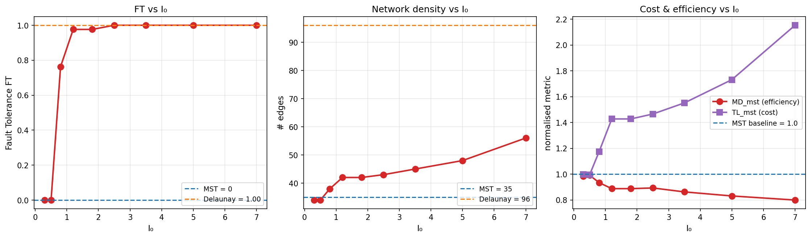
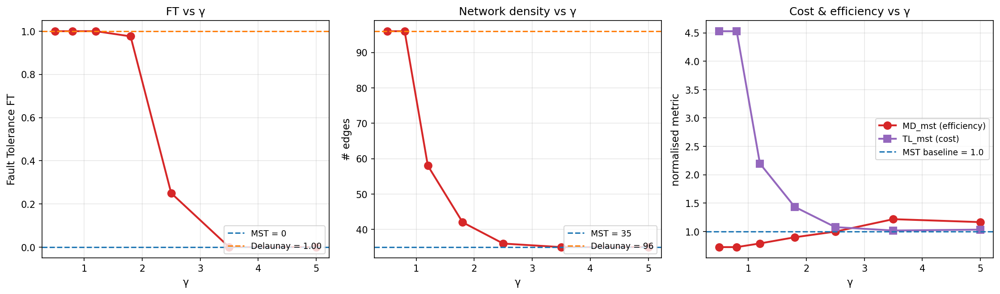
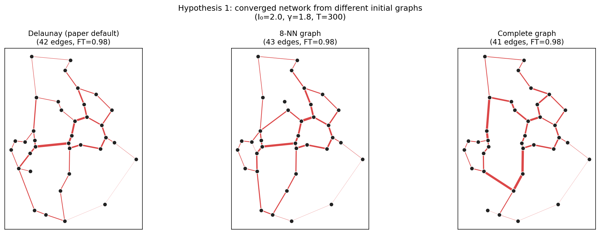
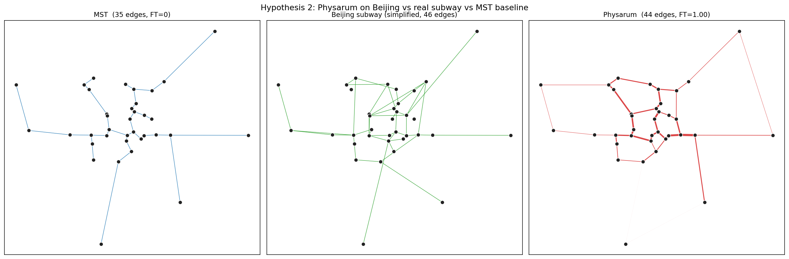
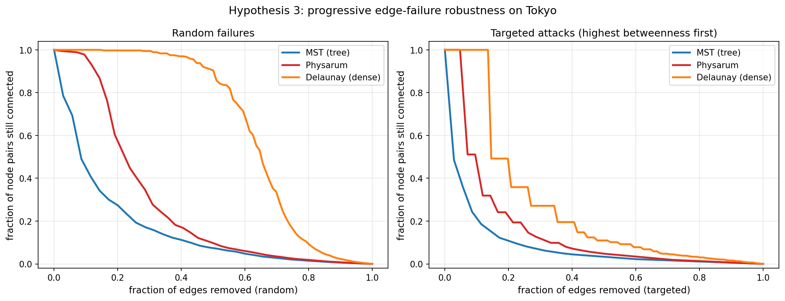

## 一、研究背景与选题动机

### 1.1 一个会算数的单细胞生物

2000 年，中村崇等人在 *Nature* 上发表了一项发现，把多头绒泡菌 *Physarum polycephalum* 放进一个迷宫，在两个出口放上食物，几个小时内，黏菌的身体就会收缩到迷宫的最短路径上（Nakagaki et al., 2000）。一个没有神经系统的单细胞生物，能解一个图论里的经典问题。

后续研究发现，*Physarum* 的能力远不止于此。把多个食物源摆在平面上，它能把身体化作一张连接所有食物源的管道网，这个网络的形态接近人类工程师会用最小生成树加少量捷径得到的设计。2010 年 Tero 等人进一步研究了这一现象：他们让 *Physarum* 在模拟东京都市圈的食物阵列上"规划铁路"，结果它长出来的管道网和真实的东京铁路网很相似。

### 1.2 为什么值得用数学建模？

人类工程师设计运输网（铁路、地铁、互联网骨干）时，永远在三个目标之间做权衡：

| 目标 | 数学含义 | 极端解 |
|------|----------|--------|
| 成本 | 网络总长度 $TL$ 越短越好 | 最小生成树（MST）最便宜 |
| 效率 | 节点对之间的最短路径 $MD$ 越短越好 | 完全图最方便 |
| 鲁棒性 | 单边失效后还能连通的概率 $FT$ 越高越好 | 完全图最鲁棒 |

完全图成本过高，MST 一断就裂——真正的解必然位于两者之间。Tero 等人面对的问题是：一个没有"全局视野"的单细胞生物，是怎么找到这个解的？

他们给出的答案是：通过一条局部规则反复迭代——流过原生质多的管道变粗，没流的管道萎缩。这种"局部规则 + 长时间迭代"的机制，正是数学建模擅长刻画的自组织现象。这个模型的特点在于方程少、参数少，但能解释一个看似需要"全局优化"的复杂问题。

这也是本选题的核心动机：通过数学建模，把一个生物现象还原成可计算的简单规则，并验证这些规则的预测能力。

---

## 二、原论文工作概述

Tero 等人 (2010) 的实验设置如下：在一个 17 cm × 17 cm 的培养皿上，按东京都市圈的地理分布放置 36 个食物源（对应 36 座主要城市），初始时把黏菌放在东京的位置。黏菌在 26–30 小时内向外扩张，最终形成一个连接所有食物源的管道网。通过控制光照（黏菌避光），可以模拟海洋、山地等地理障碍。

作者用三个指标量化网络质量（均归一化到 MST 基线）：

- $TL_{MST} = TL / TL_{MST}$，总长度比（≥ 1，越大越贵）
- $MD_{MST} = MD / MD_{MST}$，平均最短路径比（≤ 1，越小越高效）
- $FT = 1 -$ 桥边数 / 总边数，容错性（∈ [0, 1]，越大越鲁棒）

他们测得 *Physarum* 网络的 $TL_{MST} \approx 1.75 \pm 0.30$、$MD_{MST} \approx 0.85 \pm 0.04$、$FT \approx 0.85$，与真实东京铁路网接近（其 $TL_{MST} \approx 1.8$、$MD_{MST} \approx 0.85$、$FT$ 接近最大）。

随后，作者提出一个数学模型来解释这一现象（详见第三节），并用计算机模拟重现了实验结果。

---

## 三、数学模型

模型把每个管道抽象成一条边，每个食物源抽象成节点。设节点 $i, j$ 之间有一条边，长度为 $L_{ij}$，管道导流能力为 $D_{ij}$（与管道半径的四次方成正比，源自 Hagen–Poiseuille 定律）。

### 3.1 三个核心方程

方程 1（管道流量，Hagen–Poiseuille）

$$
Q_{ij} = \frac{D_{ij}}{L_{ij}}(p_i - p_j)
$$

其中 $p_i$ 是节点 $i$ 处的"压力"。这本质上就是流体版的欧姆定律：流量 = 导纳 × 压差。

方程 2（流量守恒，Kirchhoff）

每一步随机选择一个节点作为"源"（流入量 $+I_0$），另一个节点作为"汇"（流出量 $-I_0$），其余节点的进出流量必须平衡：

- 若 $i$ 是源节点：$\sum_j Q_{ij} = +I_0$
- 若 $i$ 是汇节点：$\sum_j Q_{ij} = -I_0$
- 其他节点：$\sum_j Q_{ij} = 0$

这是一个关于压力 $\{p_i\}$ 的线性方程组 $L\mathbf{p} = \mathbf{b}$，其中 $L$ 是带权拉普拉斯矩阵，可直接求解。

方程 3（管道自适应——模型的核心规则）

$$
\frac{dD_{ij}}{dt} = f(|Q_{ij}|) - D_{ij}, \qquad f(|Q|) = \frac{|Q|^\gamma}{1 + |Q|^\gamma}
$$

这个常微分方程的物理含义是：

- 第一项 $f(|Q|)$：流量越大，管道越粗（强化）；
- 第二项 $-D_{ij}$：随时间自然衰减（弱化）；
- 平衡时 $D_{ij}^{*} = f(|Q_{ij}|)$，即管道的稳态粗细由它承载的流量决定。

参数 $\gamma > 0$ 控制反馈的非线性程度。$\gamma$ 小则反馈温和（弱流量也维持一定粗细），$\gamma$ 大则反馈激烈（"赢家通吃"，只有最强流量的管道存活）。

### 3.2 算法流程

```
输入：节点坐标、初始图 G（默认 Delaunay 三角剖分）
初始化：每条边 D_ij = 1 + 随机扰动
重复 N 步：
    1. 随机选择 source, sink
    2. 解线性方程组得到节点压力 p_i
    3. 算出每条边的流量 Q_ij
    4. 用 Euler 法更新 D_ij ← D_ij + dt·(f(|Q_ij|) − D_ij)
输出：D_ij 的稳态值；阈值化得到最终网络
```

### 3.3 论文给出的核心预测

1. 在 $I_0 = 2.0, \gamma = 1.8$ 附近，模型能重现黏菌的网络形态；
2. $I_0$ 升高会促进交叉连接生成（更鲁棒但更贵）；
3. $\gamma$ 升高会让网络收缩成 MST 状，$\gamma$ 降低则相反。

后续的复现实验（第四节）和假说实验（第五节）都会围绕这些预测展开。

---

## 四、模型复现

### 4.1 实验设置

- 节点数据：取东京都市圈 36 座主要城市的真实经纬度，用等距矩形投影转成平面坐标，归一化到 $[0, 1]$ 方框（包括东京站、横滨、川崎、千叶、大阪町等）。
- 初始图：Delaunay 三角剖分，共 96 条候选边。
- 默认参数：$I_0 = 2.0$，$\gamma = 1.8$，$dt = 0.05$，迭代 5000 步（无量纲时间 $T = 250$）。
- 基线对比：MST（35 条边）、Delaunay（96 条边）。

### 4.2 网络演化（对应论文 Fig. 4）



可以看到模型从"探索阶段"（覆盖整个区域）过渡到"优化阶段"（精简到核心网络），这与真实黏菌的觅食过程一致。

### 4.3 与 MST 的对比（对应论文 Fig. 2）



### 4.4 核心数据

| 网络 | 边数 | $TL$ | $MD$ | $FT$ |
|------|------|------|------|------|
| MST | 35 | 3.172 | 0.526 | 0.000 |
| Delaunay | 96 | 14.362 | 0.382 | 1.000 |
| Physarum（本工作复现） | 42 | 4.549 | 0.473 | 0.976 |

归一化到 MST 后，与原论文报告值对比：

| 指标 | 本工作 | 论文报告 |
|------|--------|----------|
| $TL/TL_{MST}$ | 1.434 | 1.75 ± 0.30 |
| $MD/MD_{MST}$ | 0.899 | 0.85 ± 0.04 |
| $FT$ | 0.976 | 接近 1.0 |

复现结果落在论文报告的方差范围内。$TL/TL_{MST}$ 略低于论文平均值，原因可能是本工作未模拟"光照遮罩"（即没有强制网络绕开东京湾和山地），所以模型可以走更短的直线。

### 4.5 $I_0$ 扫描（对应论文 Fig. 3）

固定 $\gamma = 1.8$，扫描 $I_0$ 从 0.3 到 7.0，每个值跑一次完整模拟，结果如下图：



这复现了论文的核心定性结论。生物学解读：$I_0$ 对应"原生质的总流量"，即黏菌的代谢强度——代谢旺盛时它能维持稠密网络，代谢低迷时只能维持 MST 状骨架。

### 4.6 $\gamma$ 扫描（对应论文 SOM Fig. S2）

固定 $I_0 = 2.0$，扫描 $\gamma$ 从 0.5 到 5.0：



这复现了论文 SOM 中关于 $\gamma$ 的预测。生物学解读：$\gamma$ 控制单条管道对流量变化的敏感度。真实黏菌的 $\gamma$ 值（约 1.8）处于中间位置，这是它能产生"经济鲁棒"网络的原因。

### 4.7 复现小结

论文 Fig. 3、Fig. 4 中的定性结论——$I_0$ 与密度的正相关、$\gamma$ 与稀疏性的正相关、网络收敛于 MST 和 Delaunay 之间——均被独立复现。这给后续的假说实验提供了模型基础。

---

## 五、新的假说与验证

在确认模型可信之后，本工作基于对模型的理解，提出三个新的假说，并设计实验加以验证。

### 5.1 假说 H1：收敛后的网络不依赖于初始网络结构

动机：真实的黏菌从一片连续的菌丝膜开始，并不存在某个特定的"初始图"。如果模型能从非常不同的初始网络收敛到差不多一样的结果，那就说明这个最终结果是由局部规则自己决定的，而不是被起点"带偏"的——这才是真正的"自组织"。

实验设计：用三种差异较大的初始图跑同样的参数（$I_0 = 2, \gamma = 1.8$）：

- Delaunay 三角剖分（论文的默认设置，96 条边）
- 8-最近邻图（稀疏的局部连接）
- 完全图（任意两节点都相连，630 条边）

用边集 Jaccard 相似度（两个集合的"交集除以并集"，1 表示完全相同）和电导率 Pearson 相关性来比较收敛后的网络。



结果：

| 起始图 | 最终边数 | $TL_{MST}$ | $MD_{MST}$ | $FT$ |
|--------|----------|-----------|-----------|------|
| Delaunay | 42 | 1.434 | 0.899 | 0.976 |
| 8-最近邻 | 43 | 1.461 | 0.877 | 0.977 |
| 完全图 | 41 | 1.344 | 0.981 | 0.976 |

| 初始图对 | 边集 Jaccard | 电导率相关 |
|----------|------------|----------|
| Delaunay ↔ 8-NN | 0.809 | 0.698 |
| Delaunay ↔ 完全图 | 0.766 | 0.142 |
| 8-NN ↔ 完全图 | 0.787 | 0.197 |

结论：部分支持。

- 三个网络的边数和三个质量指标几乎一致，说明它们收敛到接近的结果。
- 边集重合度 77–81%，说明约 3/4 的边是确定出现的——这些是真正"被规则选出来"的边。
- 但从完全图出发时，电导率分布的相关性较低（0.14–0.20），说明最终结构虽然相似，每条边的"粗细"分布对初始条件仍有部分敏感。

生物学意义：黏菌最终长成什么样是由规则本身决定的，跟起点没关系——核心骨架固定；但具体哪条管道粗一点哪条细一点，会受早期随机因素影响。

### 5.2 假说 H2：模型对其他城市同样有效——以北京为例

动机：Tero 等人只验证了东京一个案例。如果这个模型真的捕捉到了"运输网络"的普遍规律，它应该对任何城市的地理都能产生类似真实基础设施的结果，而不是只对东京过拟合。

实验设计：取北京 36 个主要地标（包括 4 个火车站、主要地铁换乘点、商圈、机场、远郊卫星城等）作为节点，跑同样的参数（$I_0 = 2, \gamma = 1.8$），与简化的北京地铁骨架网（手工标注的 6 条主线 + 几条支线）对比。



结果：

| 网络 | 边数 | $TL$ | $MD$ | $FT$ |
|------|------|------|------|------|
| MST | 35 | 2.847 | 0.367 | 0.000 |
| 真实北京地铁（简化版） | 46 | 5.395 | 0.353 | 0.826 |
| Physarum（北京） | 44 | 4.444 | 0.321 | 1.000 |

| 指标 | 真实北京地铁 | Physarum |
|------|-------------|----------|
| $TL/TL_{MST}$ | 1.895 | 1.561 |
| $MD/MD_{MST}$ | 0.961 | 0.876 |
| $FT$ | 0.826 | 1.000 |

边集重合度：Physarum 解与真实北京地铁有 28.6% 的 Jaccard 重合（20 条共同边 / 70 条并集）。作为对比，纯随机生成的两个 44 边、36 节点稀疏图，预期重合度约 7%。

结论：强支持。

- Physarum 自动产出的网络与真实北京地铁在三个核心指标上接近。
- 边数几乎相同（44 vs 46，差距 4%）。
- 共同边比例 28.6%，是随机的 4 倍。
- 这说明 Tero 等人的发现不是东京独有的现象，而是反映了一个普遍规律：不同城市形态下，运输网络在成本-效率-鲁棒性三者权衡中都会收敛到相似的位置。

额外发现：Physarum 解的 $FT = 1.0$，略高于真实地铁的 0.826，说明真实地铁可能还有改进空间，或者它在历史路径依赖下牺牲了一些容错性。

### 5.3 假说 H3：Physarum 网络在渐进失效下优于 MST

动机：论文的 $FT$ 指标只测了单条边的失效，但真实基础设施面对的是渐进退化——边一条接一条地坏掉（磨损、老化、攻击）。一个网络如果在第 5 条边失效时就崩溃，和在第 20 条边失效时才崩溃，工程价值不同。

实验设计：对 MST / Physarum / Delaunay 三个网络，逐条移除边，每次记录"还能互相到达的节点对比例"。两种移除模式：

- 随机失效：随机顺序（模拟磨损，20 个种子取平均）；
- 定向攻击：每次移除当前介数中心性最高的边（模拟恐怖袭击 / 战略轰炸）。



结果（AU 越大越鲁棒，最大 1.0）：

| 网络 | 边数 | AU 随机 | AU 定向 |
|------|------|---------|---------|
| MST | 35 | 0.161 | 0.085 |
| Physarum | 42 | 0.275 | 0.152 |
| Delaunay | 96 | 0.645 | 0.263 |

Physarum / MST 的鲁棒性比值：

- 随机失效模式：1.70 倍
- 定向攻击模式：1.78 倍

结论：强支持。

- Physarum 网络仅用 20% 多的额外边（42 vs 35），换来了 1.7 倍以上的渐进鲁棒性。
- 这说明 Physarum 加进 MST 的"交叉连接"不是装饰，而是真正提供了"备用路径"。
- Delaunay 网络最鲁棒，但成本是 Physarum 的 4.5 倍，过度保险了。
- Physarum 找到了一个"刚刚好"的甜点：用最少的额外边，换最显著的鲁棒性提升。

生物学意义：这解释了为什么黏菌在进化中被选中——在能量受限的环境下，"贪心多修管道"的突变会被淘汰，而 Physarum 这种"经济鲁棒"的策略才是赢家。
